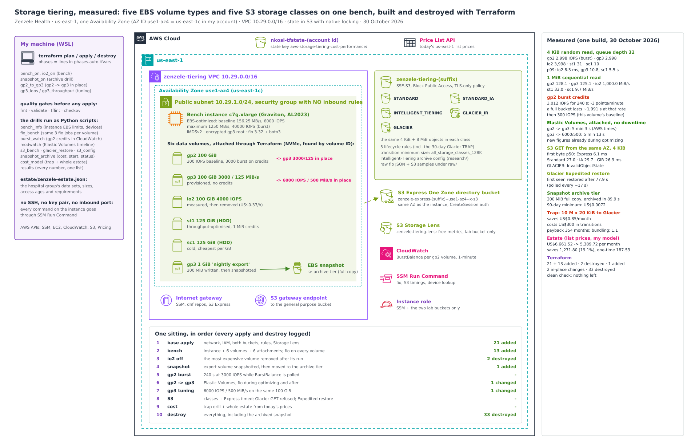

# Storage tiering, measured: what each EBS volume type and S3 storage class costs and delivers

A hospital group's storage bill doubled in a year, and the proposed fix was "move everything old to Glacier". Before anyone touched production, I measured the options on one bench:

- **five EBS volume types** (gp2, gp3, io2, st1, sc1), with the same fio jobs on the same instance;
- **gp2 burst credits** draining in CloudWatch;
- **gp2 → gp3 with no downtime**, and more gp3 performance without a bigger volume (Elastic Volumes), measured during and after the change;
- **S3 read latency** from the same Availability Zone, for five storage classes and **S3 Express One Zone**, plus what an archived Glacier object means for an application;
- **an EBS snapshot moved to the archive tier**, with its 90-day minimum priced first;
- **the "small files to Glacier" trap**, and a cost model of the whole estate from AWS's own list prices.

Everything is declared in **Terraform** and was built, measured and destroyed in one sitting.



## The scenario: Zenzele Health

Zenzele Health (a fictional South African private hospital group) keeps:
- a **PACS imaging archive** (X-ray, CT and MRI studies, about 40 TiB), all in S3 Standard;
- **lab results**: one small file (about 20 KiB) per result, millions of them, also in Standard;
- **application databases** on gp2 (12 × 500 GiB) that slow down at month end, and the **EMR database** on io2;
- **nightly database exports** that nobody has ever deleted, and export staging volumes on gp2;
- **application and audit logs**, in Standard forever;
- **monthly database snapshots** kept for seven years "for compliance".

**What I set out to answer, with measurements:**
- What does each EBS volume type really deliver, and where does the instance cap it?
- Why do the gp2 databases slow down at month end, and can they move to gp3 without downtime?
- What does each S3 storage class mean for a read, and what does "archived in Glacier" mean for an application?
- What would "move the lab results to Glacier" really cost?
- What would Zenzele's whole storage bill be with sensible tiering?

## Results

All numbers come from one build on 30 October 2026:
- [`docs/results/summary.txt`](docs/results/summary.txt), with every raw file in [`docs/results/`](docs/results/);
- 27 screenshots ([index](docs/screenshots.md)).

Times are UTC. The bench instance was a **c7g.xlarge** in **use1-az4** (us-east-1c in my account).

**EBS, same instance, same fio jobs** ([details](docs/ebs-volumes.md)). 4 KiB jobs at queue depth 32, 1 MiB reads at queue depth 16, 20 s each:

| Volume | 4 KiB random read IOPS (p99) | 4 KiB random write IOPS (p99) | 1 MiB sequential read MiB/s (p99) | What AWS documents for this size |
|---|---|---|---|---|
| gp2 100 GiB | 2,998 (11.2 ms) | 2,998 (10.8 ms) | 128.1 (126 ms) | 300 IOPS baseline, **3,000 while burst credits last**, up to 128 MiB/s |
| gp3 100 GiB | 2,998 (10.8 ms) | 2,998 (10.9 ms) | 125.1 (128 ms) | 3,000 IOPS / 125 MiB/s provisioned, no credits |
| io2 100 GiB, 4,000 IOPS | 3,998 (8.3 ms) | 3,998 (8.2 ms) | 1,000.0 (17 ms) | 4,000 IOPS provisioned |
| st1 125 GiB (HDD) | 31 (1.7 s) | 31 (1.7 s) | 33.0 (726 ms) | 4.9 MiB/s baseline, 30.5 burst; every I/O costs a 1 MiB credit |
| sc1 125 GiB (HDD) | 10 (5.5 s) | 10 (5.5 s) | 9.7 (2.8 s) | 1.5 MiB/s baseline, 9.8 burst |

| What else I measured | Result |
|---|---|
| **gp2 burst credits** ([details](docs/gp2-burst-credits.md)) | 3,012 IOPS for 240 s cost **3 points of BurstBalance per minute**, exactly what 2,712 credits/s out of a 5.4-million bucket predicts. A full bucket lasts about **1,991 s (33 minutes)** at that rate; after that this volume drops to its 300 IOPS baseline. |
| **gp2 → gp3 in place** ([details](docs/elastic-volumes.md)) | Terraform: `1 to change`, an in-place update; it returned after 13 s. AWS took **5 min 3 s** from start to `completed`. fio ran **while the volume was optimizing**: 2,998 IOPS, 125 MiB/s, the same as after. The volume stayed attached throughout. |
| **gp3 3,000/125 → 6,000 IOPS / 500 MiB/s**, same 100 GiB | `completed` after **5 min 13 s**. Already **5,998 IOPS and 500 MiB/s during optimizing**, 51 s after the change started. 500 MiB/s is above the instance's EBS **baseline** (156.25 MB/s), so that run used the instance's own burst. |
| **S3 GET from the same AZ** ([details](docs/s3-storage-classes.md)) | 4 KiB, time to first byte p50: **Express One Zone 6.1 ms**; Standard 27.0, Standard-IA 29.7, Intelligent-Tiering 27.6, Glacier IR 26.9 ms. 8 MiB: Express **142.9 MiB/s**, the others about 89. |
| **An object in Glacier Flexible Retrieval** | GET refused: **`InvalidObjectState`**. Expedited restore requested at 08:28:16.726, **first seen restored 77.9 s later**. The object stays in `GLACIER`; the restore is a temporary copy. |
| **Lifecycle rules S3 holds** | 5 rules, including the proposed "lab results to Glacier after 30 days", **and** the bucket's `TransitionDefaultMinimumObjectSize = all_storage_classes_128K`: objects under 128 KB never transition, so the 20 KiB lab results would never move. |
| **EBS snapshot archive** ([details](docs/snapshot-archive.md)) | 200 MiB written to a 1 GiB volume → full snapshot size **209,715,200 bytes**. 90-day minimum priced before archiving: **US$0.0072**. Archived in **89.9 s**. Deleted while archived during the destroy (1 s). |
| **The trap: 10 million 20 KiB lab results to Glacier** ([details](docs/cost-model.md)) | Saves **US$0.85 a month**, costs **US$300 in transition requests** up front: payback **354 months**. Glacier IR and Standard-IA cost *more* than Standard (128 KiB minimum billable size). Bundling the files into 512 MiB objects first: US$4.01 one-time, payback **1.1 months**. |
| **Zenzele's estate, list prices** | **US$6,661.52 → US$5,389.72 a month** (saves US$1,271.80, 19.1%), one-time US$187.53. The model is mine, the prices are AWS's ([assumptions](docs/cost-model.md)). |
| **Terraform** ([details](docs/terraform.md)) | Base `21 added` (state 23) · bench `13 added` (36) · io2 off `2 destroyed` (34) · snapshot `1 added` · two in-place volume changes `1 changed` each · **`Destroy complete! Resources: 33 destroyed.`** Clean check empty. |

## How it works

- **One bench instance, six data volumes.**
  - A c7g.xlarge (Graviton, Amazon Linux 2023), EBS-optimized, with no inbound security group rules: every command reaches it through **SSM Run Command**.
  - Six volumes: gp2, gp3, io2, st1, sc1, and a 1 GiB "nightly export" volume for the snapshot drill. On a Nitro instance they appear as NVMe devices in no fixed order, so the agent finds each one by its volume ID (the NVMe serial number) and refuses any mounted device. It can never touch the root volume.
- **The same fio jobs on every volume.** A 128 MiB sequential prefill, then 4 KiB random reads, 4 KiB random writes and 1 MiB sequential reads, 20 s each after a 2 s warm-up. Direct I/O on the raw device, inside the prefilled area, so no read is flattered by never-written blocks.
- **One Availability Zone, by ID.** The subnet, the instance, its volumes and the S3 Express One Zone directory bucket all use AZ ID `use1-az4`. AZ IDs are the same in every account; AZ names are not.
- **Two buckets.** A general purpose bucket (SSE-S3, Block Public Access, TLS-only policy, lifecycle rules, an Intelligent-Tiering archive configuration) reached through an S3 gateway endpoint, and an Express One Zone directory bucket in the instance's AZ. Plus a free-metrics **S3 Storage Lens** configuration for the lab bucket.
- **Prices come from the AWS Price List API** on the day, never from memory. Every raw price record is kept in [`pricing-raw.jsonl`](docs/results/pricing-raw.jsonl).
- **The scripts in [`scripts/`](scripts/):**

  | Script | What it does |
  |---|---|
  | `bench_info.py` | The instance type's EBS limits from EC2; fio, boto3 and every volume's device on the instance |
  | `fio_bench.py` | The same fio jobs on each volume, next to the documented figure |
  | `burst_watch.py` | A 240 s gp2 run while BurstBalance is polled in CloudWatch |
  | `modwatch.py` | An Elastic Volumes change: states and timestamps, fio during and after |
  | `s3_bench.py` | PUT and timed GETs per storage class and in Express One Zone, from the instance |
  | `glacier_restore.py` | The refused GET, then an Expedited restore, timed |
  | `s3_config.py` | Reads back lifecycle, Intelligent-Tiering, Storage Lens and objects by class |
  | `snapshot_archive.py` | Fills the export volume, prices the archive's 90-day minimum, archives, tracks status |
  | `cost_model.py` | The trap drill and the whole estate from today's list prices |
  | `results.py` | Collects every measured number into one summary |

  [`app/bench_agent.py`](app/bench_agent.py) is the agent that runs on the instance. Terraform passes it in as gzipped user data.

More detail:
- [EBS volume types](docs/ebs-volumes.md)
- [gp2 burst credits](docs/gp2-burst-credits.md)
- [Elastic Volumes](docs/elastic-volumes.md)
- [S3 storage classes, Express One Zone and Glacier](docs/s3-storage-classes.md)
- [snapshot archive](docs/snapshot-archive.md)
- [cost model and the trap](docs/cost-model.md)
- [Terraform](docs/terraform.md)
- [debugging journey](docs/debugging-journey.md)
- [teardown](docs/teardown.md)
- [decisions (ADRs)](docs/adr/)

## Why Terraform

I used to build labs like this with long chains of AWS CLI commands: create a volume, capture its ID, attach it, modify it, then do it all again in reverse to tear down. With six volumes, two buckets and a snapshot, that is a lot of IDs to carry between commands, and a forgotten delete means a surprise on the bill.

Here every phase is one line in `infra/phases.auto.tfvars`:
- `bench_on = true` and `io2_on = true` for the instance and volumes;
- `snapshot_on = true` for the snapshot;
- `gp2_to_gp3 = true` for the migration;
- `gp3_iops = 6000` and `gp3_throughput = 500` for the tuning.

Each one becomes a reviewed plan. Removing `io2_on` removed exactly the expensive volume, and the whole project is one `terraform destroy`. State lives in a shared S3 bucket with S3-native locking.

## What went wrong, and what I changed

The full story is in [docs/debugging-journey.md](docs/debugging-journey.md).

- **My cost model used the wrong transition prices.**
  - In the Price List, `Requests-Tier3` covers three products and `Requests-Tier4` covers four, each with its own price. My lookup took the first match. For Glacier transitions that was the **Deep Archive** price (US$0.05 per 1,000 instead of US$0.03), and for Glacier IR the One Zone-IA price (US$0.01 instead of US$0.02).
  - The run printed "3 products matched, first used". I only caught it when I checked the raw records.
  - I fixed the lookup to pin each price to its operation (`S3-GlacierTransition`, `S3-GIRTransition`...) and to **refuse** any lookup that matches more than one product. Then I recomputed from the same day's raw price records. The trap's Glacier one-time cost went from US$500 to **US$300**, and the estate total from US$5,392.59 to **US$5,389.72**. The output exactly as it ran is kept in [`as-run/`](docs/results/as-run/), and the screenshots of the trap and the estate show those original numbers.
- **The burst watcher stopped polling too early.**
  - The AWS CLI returned CloudWatch timestamps in my local time zone (+02:00), while my script compared them as text with UTC times. The string "09:54" sorts after "07:55", so the script decided the last datapoint had arrived and stopped before the run's final minute was published.
  - That is why the decline reads 10 points instead of the 12.06 the IOPS predict, and why the slope came out as `None`. The minutes that did arrive show exactly 3 points per minute.
  - I fixed it by converting every timestamp to UTC before comparing.
- **The Glacier Deep Archive storage price matched no product** in the Price List lookup. Nothing in the model uses it, so I removed it rather than leave a lookup that always fails.

## Compliance and frameworks

| Framework | What applies | What I built | Gap I'd close in production |
|---|---|---|---|
| **POPIA** (South Africa), section 19, and **HIPAA** Security Rule (§164.312) where US patient data is involved | Appropriate safeguards for health information: encryption, access control, integrity | Every EBS volume and the snapshot encrypted; SSE-S3 on the bucket; Block Public Access; a TLS-only bucket policy; an instance role scoped to the two lab buckets; no inbound ports (SSM only) | KMS customer managed keys (checkov flagged both); S3 access logging; Object Lock for records that must not change |
| **ISO/IEC 27001:2022** | A.8.13 information backup, A.8.10 information deletion, A.8.32 change management | Snapshot to archive tier with its cost known first; lifecycle expiry for exports and logs; every change through a reviewed Terraform plan | A documented retention schedule per data set, signed off by the records owner |
| **NIST SP 800-53 Rev. 5** | SC-28 protection of information at rest, SC-8 transmission confidentiality, AC-6 least privilege, CM-3 configuration change control | Encryption at rest everywhere; TLS enforced on the bucket; least-privilege instance role; IMDSv2 | VPC flow logs; versioning on the data bucket |

Retention periods (seven years of snapshots, 400 days of logs) are business and legal decisions. This lab shows what each one costs, not what the law requires.

## Repo layout

```
app/              bench_agent.py: runs on the instance (fio, device lookup, S3 timings), called through SSM
bootstrap/        the shared Terraform state bucket (one-time)
estate/           zenzele-estate.json: the storage estate the cost model prices
infra/            network, IAM, both buckets + rules + Storage Lens, the bench instance and volumes
scripts/          bench_info, fio_bench, burst_watch, modwatch, s3_bench, glacier_restore, s3_config,
                  snapshot_archive, cost_model, results (+ helpers kit_aws, lab, ssm_run, pricing, specs)
docs/             architecture, write-ups, ADRs, results (as measured + raw), screenshots
```

## Reproduce it

From the repo folder, with AWS CLI v2, Terraform 1.11 or newer, Python 3, and an existing state bucket:

```bash
cp env.sh.example env.sh && mkdir -p build/results && source ./env.sh
echo "name_suffix = \"$(od -An -N4 -tx1 /dev/urandom | tr -d ' \n')\"" > infra/name.auto.tfvars
terraform -chdir=infra init -backend-config="bucket=<your state bucket>"
terraform -chdir=infra apply                                       # 21 resources
printf 'bench_on = true\nio2_on   = true\n' >> infra/phases.auto.tfvars
terraform -chdir=infra apply && python3 scripts/bench_info.py && python3 scripts/fio_bench.py --label base
sed -i '/^io2_on/d' infra/phases.auto.tfvars && terraform -chdir=infra apply
python3 scripts/burst_watch.py && python3 scripts/s3_bench.py && python3 scripts/cost_model.py
terraform -chdir=infra destroy
```

The other drills follow the same pattern: one line in `infra/phases.auto.tfvars`, apply, run the script. It costs about a dollar for a two-hour sitting; the io2 volume is the expensive part, so it comes off first. Always destroy afterwards ([teardown and clean check](docs/teardown.md)).

## What I'd tell the next team

- **gp2 databases that slow down at month end are running out of burst credits.** A 500 GiB gp2 volume has a 1,500 IOPS baseline; it can only hold 3,000 while credits last. gp3 gives 3,000 IOPS at any size for 20% less per GB, and the move is in place, with the volume attached.
- **Raise gp3 performance without growing the volume,** but check the instance first. 500 MiB/s is above a c7g.xlarge's EBS baseline; it only lasts as long as the instance's own burst.
- **Never lifecycle millions of small files to Glacier.** Per-object metadata and transition requests eat the saving, and since 2024 S3 won't move objects under 128 KB by default anyway. Bundle them first.
- **"Archived" means "not readable".** Glacier Flexible Retrieval refuses the GET until a restore finishes. If an application needs milliseconds, use Glacier Instant Retrieval or Intelligent-Tiering.
- **The snapshot archive tier keeps full copies.** It only pays when each snapshot's unique data is large compared with a full copy. For a chain of monthly incrementals it costs more, so Zenzele's compliance snapshots stay in the standard tier.
- **Treat a price lookup that matches several products as an error.** One easy-to-miss "first match" made my trap's transition bill 67% too high.
